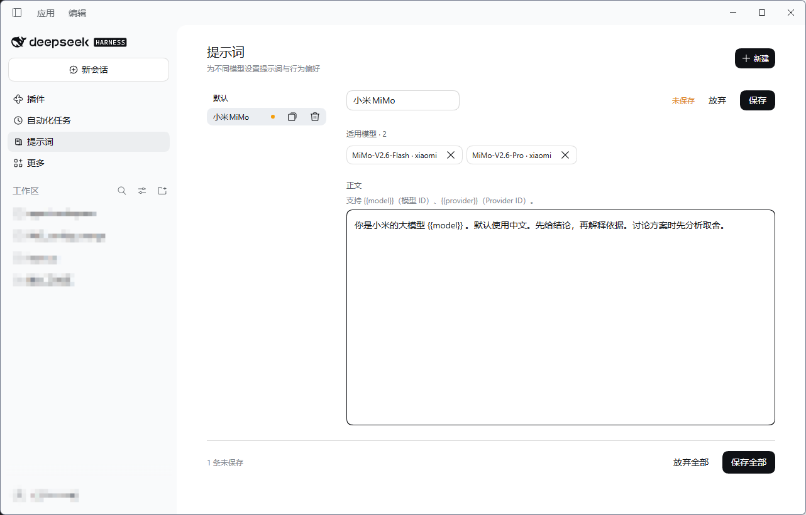

# Prompts

[简体中文](README.md)

Set prompts and behavioral preferences for individual models in DeepSeek Harness. Since the workspace's `AGENTS.md` is loaded by default, this plugin uses the **persona prefix** (`deployment:persona-prefix`) in the system prompt to accommodate different models' styles. DSH continues to provide mode policies, tool rules, and other standard content.

The plugin only takes effect in **Standard and other modes that use this prefix**. Modes such as Minimal that supply a complete prompt use their own prompt and are unaffected by this plugin.



## Installation and usage

In DSH, open **Plugins → Add plugin** and enter the GitHub URL `https://github.com/norths7ar/dsh-model-guidance`. Install and enable the plugin, then open **Prompts** from the sidebar.

Assign models to a prompt and save it. Changes take effect on the next model request. Bindings distinguish providers and models and apply across conversations in the same DSH profile, including subagents that use the same persona-prefix section. Models without a binding, or with an empty prompt, keep their default content.

## Placeholders

Prompts support DSH placeholders: `{{model}}` inserts the current model ID, and `{{provider}}` inserts the provider ID. For example:

```text
Your model is {{model}}, provided by {{provider}}.
```

These are IDs, not display names. Use the exact syntax, such as `{{model}}`, without spaces inside the braces. Unknown placeholders cause a request error, and placeholders inside code blocks are parsed too.

## Compatibility and development

The current verified host is **DSH Desktop 0.2.2-rc.3**.

With Node.js 24, run these commands in the project directory:

```sh
npm ci
npm run check
npm run format
npm pack --dry-run
```

`check` runs lint, formatting checks, and offline tests without calling models.

## License

[MIT](LICENSE)
