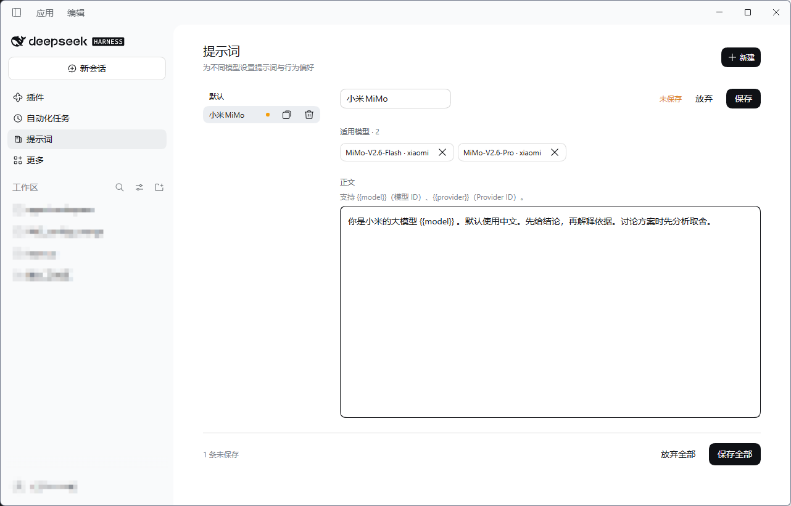

# 提示词

[English](README.en.md)

为 DeepSeek Harness 中的不同模型设置提示词与行为偏好。因为工作区中的 `AGENTS.md` 会被默认加载，所以本插件利用了系统提示词中的**角色前缀**（`deployment:persona-prefix`）为不同风格的模型做适配。DSH 负责继续提供模式策略、工具规则等其他标准内容。

本插件只在**标准模式等使用了此前缀的模式**下生效，Minimal 等采用完整提示词的模式使用自身的提示词，不受本插件影响。



## 安装与使用

在 DSH 的 **插件 → 添加插件** 中输入 GitHub 链接 `https://github.com/norths7ar/dsh-model-guidance`，安装并启用后，从侧栏打开 **提示词**。

为提示词选择适用模型并保存后，从下一次模型请求开始生效。绑定按 Provider 和模型区分，在同一 DSH 配置下跨会话使用，也适用于使用相同角色前缀的子智能体。未绑定或正文为空的模型继续使用默认内容。

## 占位符

提示词支持 DSH 的占位符：`{{model}}` 填入当前模型 ID，`{{provider}}` 填入 Provider ID。例如：

```text
你使用的模型是 {{model}}，由 {{provider}} 提供。
```

使用 ID 而非显示名称。请保持 `{{model}}` 这样的写法，括号内不加空格；未知占位符会导致请求报错，放在代码块内也会被解析。

## 兼容性与开发

当前验证版本为 **DSH Desktop 0.2.2-rc.3**。

使用 Node.js 24，在项目目录运行：

```sh
npm ci
npm run check
npm run format
npm pack --dry-run
```

`check` 包含 lint、格式检查和离线测试，不调用模型。

## 许可证

[MIT](LICENSE)
